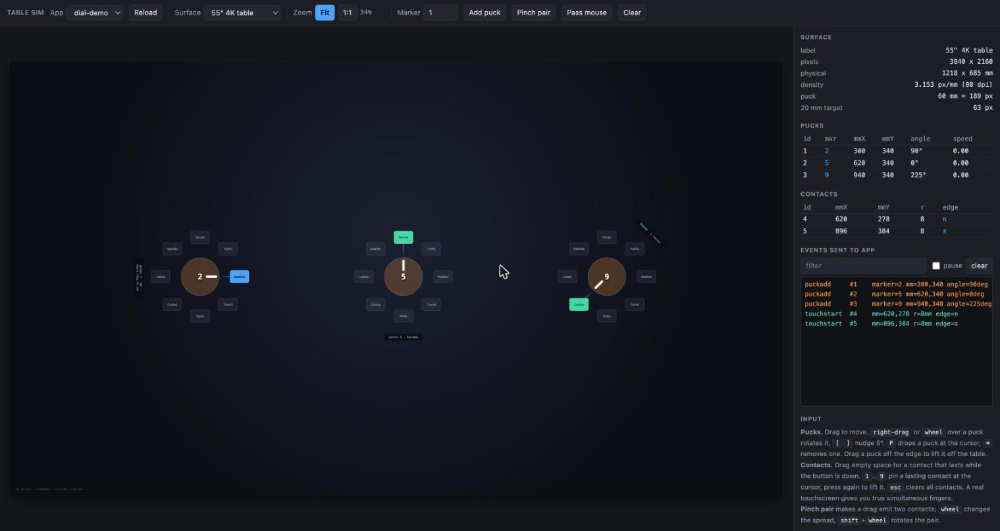
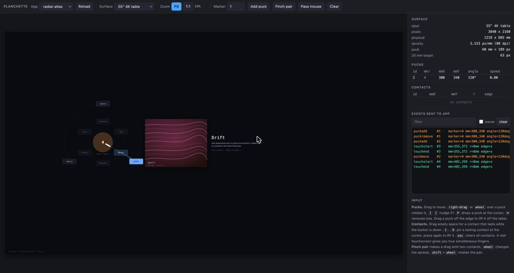
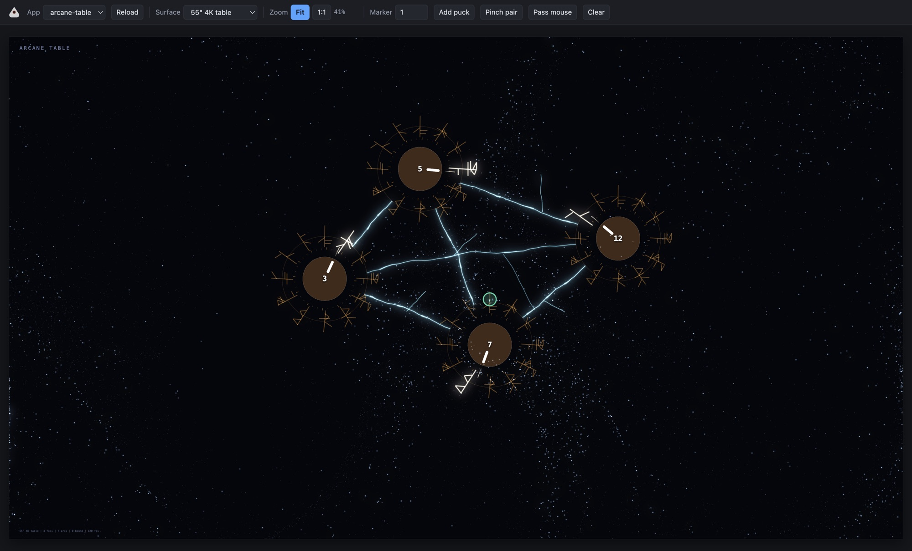

# Planchette

A simulator for a large multitouch table that also tracks **pucks**: physical
objects placed on the surface, each reporting its own identity, position, and
rotation. It runs on an ordinary laptop, so designers can build and iterate on
table interfaces without the hardware in front of them.

Interfaces are plain HTML, CSS, and JavaScript. No build step, no framework.



## Why this exists

The table is a MultiTaction-style display: a 55 inch 4K surface that recognises
optical markers (Codice tags) on physical pucks. There is normally one of them,
in one place, and it is not on anybody's desk. Without a stand-in, designing for
it means guessing, and the guesses are usually wrong in the same two ways:
sizing, because a layout that looks right in a browser window is comically
mis-scaled on a 1218mm surface, and interaction, because a laptop encourages
hover states, modal dialogs, and a single cursor, none of which exist on a table
that four people are using at once.

So the simulator is opinionated about both. It lays out every interface at the
table's true resolution, reports physical millimetres, and gives you several ways
to fake simultaneous contacts.

## Quick start

    npm install
    npm run dev          # then open http://localhost:5173

Pick an interface from the **App** menu, then:

- **Pucks.** Drag to move. Right-drag or scroll over a puck to rotate it,
  `[` and `]` nudge 5°. `P` drops one at the cursor, backspace removes it. Drag a
  puck off the edge to lift it off the table.
- **Contacts.** Drag empty space for a contact that lasts while the button is
  down. `1`…`9` pin a lasting contact at the cursor. `esc` clears them. A real
  touchscreen gives you genuinely simultaneous fingers.
- **Pinch pair** makes a drag emit two contacts; scroll changes the spread,
  shift-scroll rotates the pair.

The inspector on the right shows every value the interface is being sent, which
is where most debugging happens.

## Writing an interface

Pull state for anything that draws, push events for discrete moments.

```js
import { table } from '@planchette/sdk'

table.ready(({ surface }) => {
  requestAnimationFrame(function loop() {
    const { pucks, touches } = table.state()
    for (const p of pucks) {
      // Millimetres in, pixels out. p.angle is radians, 0 = up, clockwise.
      place(el, table.mm(p.mmX), table.mm(p.mmY), p.angle)
    }
    requestAnimationFrame(loop)
  })
})

table.on('puckadd', (p) => openPanelFor(p.markerId))
table.on('touchstart', (t) => {
  const puck = table.nearestPuck(t.mmX, t.mmY, 80)   // millimetres
})
```

In CSS, work in millimetres through the variables the SDK publishes:

```css
.button { min-width: calc(20 * var(--mm)); }
.ring   { width: calc(var(--puck-d) + 40 * var(--mm)); }
```

**Read [`docs/HOUSE-RULES.md`](docs/HOUSE-RULES.md) before writing anything.** It
has the full API and the design rules that decide whether an interface survives
contact with the real table. [`docs/EVENT-API.md`](docs/EVENT-API.md) documents
the data model and wire protocol.

## Examples

| Folder                | What it demonstrates                                                             |
| --------------------- | -------------------------------------------------------------------------------- |
| `apps/_template/`     | The smallest thing that works. Copy this to start.                               |
| `apps/dial-demo/`     | A puck as a rotary dial. DOM and CSS transforms, millimetre geometry, per-puck state for several users at once. |
| `apps/radial-atlas/`  | Multi-level radial menus, and loading real content: a local `content.json` plus image files on disk. |
| `apps/arcane-table/`  | A Three.js showcase: bloom, a flowing particle field, procedural runes, and electrical arcs between pucks. |



An interface folder is an ordinary static site. It can reference any local
script, stylesheet, image, font, model, or shader at any depth, and remote
`https` URLs as well, including ES module imports from a CDN.



`arcane-table` is also the reference for the three things that catch people out
in WebGL on a table: never multiply by `devicePixelRatio` (the surface is already
at native resolution), never use `THREE.Line` (WebGL clamps line width to one
pixel, which is 0.3mm here), and size everything in millimetres.

## The desktop app

`npm run dist:mac` / `dist:win` produce a double-clickable app for people who do
not want a terminal. It still lets them author interfaces: apps live in a
**workspace** folder on disk, seeded on first run with the examples, SDK type
declarations, and the design rules. The app watches that folder, so saving a file
reloads the interface with the pucks left where they were.

See [`docs/DISTRIBUTION.md`](docs/DISTRIBUTION.md) for packaging, code signing,
and what a first-time user has to click past.

## Layout

| Path                    | What it is                                                        |
| ----------------------- | ----------------------------------------------------------------- |
| `src/host/`             | The simulator: surface geometry, state model, input, inspector, app hosting. |
| `src/sdk/`              | `@planchette/sdk`, the only module an interface imports.                |
| `apps/<id>/`            | Example interfaces. Seeded into a fresh workspace.                |
| `electron/`             | The desktop shell: custom protocol, workspace, file watching.      |
| `scripts/`              | Workspace seed assembly, ad-hoc signing, the smoke test.           |
| `docs/`                 | Design rules, wire protocol, distribution.                         |

## Scripts

| Command                | What it does                                                       |
| ---------------------- | ------------------------------------------------------------------ |
| `npm run dev`          | Vite dev server. The main development loop.                        |
| `npm run check`        | TypeScript, no emit.                                               |
| `npm run smoke`        | Launches the real desktop shell and drives it over CDP.            |
| `npm run build`        | Host bundle, standalone SDK, standalone Three.                     |
| `npm run electron:dev` | The Electron shell pointed at the dev server.                      |
| `npm run dist:mac`     | Signed-ad-hoc `.dmg` and `.zip` in `release/`.                     |
| `npm run dist:win`     | Installer and portable `.exe` in `release/`.                        |

## Relationship to real hardware

The data model deliberately mirrors [TUIO](https://www.tuio.org/), the open
protocol for tangible surfaces: normalized coordinates, radians, a session id
distinct from the marker class. MultiTaction's own stack can emit TUIO, so a
hardware bridge is a transport swap behind `src/sdk/transport.ts` rather than a
rewrite. No bridge is built yet.

## Not built yet

- **Fidelity knobs** for marker jitter, dropout, and input latency. Currently the
  simulator is perfect in a way real Codice tracking never is, which risks
  teaching habits that break on the hardware. This is the highest-value next
  thing.
- **Record and replay** of input sessions, for repeatable interactions.
- **Trusted multi-touch.** Events delivered to an interface are synthesized, so
  native pinch-zoom and `touch-action` behaviour do not fire. Fixing it properly
  means CDP touch injection in the Electron build.
- **Multiple interfaces at once** in separate regions of the table.
- **A hardware TUIO bridge**, and an app icon.
